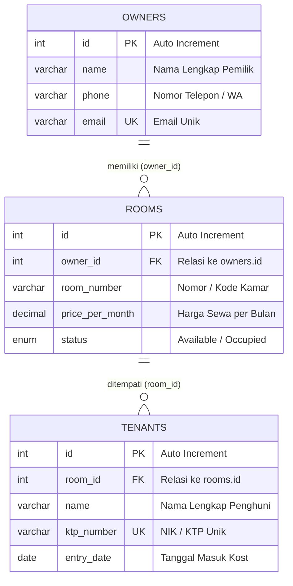

# SatuAtap - Sistem Manajemen Kost

> **Tugas Praktikum 7 (TP7) Desain dan Pemrograman Berorientasi Objek (DPBO)**  
> **Program Studi Ilmu Komputer - Universitas Pendidikan Indonesia**

### 👤 Identitas Mahasiswa
- **Nama**: Muhiban Fadlan Nursaid
- **NIM**: 2400382
- **Kelas**: DPBO C1
- **Janji**: Saya Muhiban Fadlan Nursaid dengan NIM 2400382 mengerjakan Tugas Praktikum 7 dalam mata kuliah Desain dan Pemrograman Berorientasi Objek untuk keberkahan-Nya maka saya tidak melakukan kecurangan seperti yang telah dispesifikasikan. Aamiin.
---

## 1. 🏠 Penjelasan Tema Website

**SatuAtap** adalah platform sistem informasi manajemen pengelolaan rumah kost berbasis web yang dibangun menggunakan bahasa pemrograman **PHP** dengan paradigma **Object-Oriented Programming (OOP)**, **PDO (PHP Data Objects)**, dan database relasional **MySQL**.

### Latar Belakang & Tujuan
Pengelolaan bisnis kost konvensional seringkali menghadapi kendala dalam pencatatan data yang tersebar, kesulitan memantau kamar mana yang masih tersedia atau sudah terisi, serta pencatatan identitas penghuni yang tidak terhubung langsung dengan unit kamar dan pemilik properti.

Aplikasi **SatuAtap** hadir untuk:
1. **Sentralisasi Data Properti**: Memusatkan pendataan seluruh pemilik kost, kamar yang disewakan, dan penghuni aktif dalam satu aplikasi.
2. **Otomatisasi Status & Relasi**: Memastikan setiap kamar terikat dengan pemilik yang sah (*ownership*) dan setiap penghuni tercatat secara jelas pada kamar yang disewanya.
3. **Kemudahan Operasional CRUD**: Menyediakan antarmuka yang intuitif untuk membuat (*Create*), membaca (*Read*), memperbarui (*Update*), dan menghapus (*Delete*) data di setiap modul secara efisien.

---

## 2. 🗄️ Penjelasan Database

Aplikasi menggunakan database bernama **`db_satuatap`** dengan engine **InnoDB** untuk mendukung integritas referensial antar-tabel (*Foreign Key Constraints* dan *Cascade Delete*).

### Struktur Tabel



### Rincian Atribut Setiap Tabel

#### a. Tabel `owners` (Data Pemilik Kost)
Menyimpan identitas pemilik properti kost:
- `id` (INT, Primary Key, Auto Increment): Identifikator unik untuk setiap pemilik.
- `name` (VARCHAR(100), NOT NULL): Nama lengkap pemilik kost.
- `phone` (VARCHAR(20), NOT NULL): Nomor kontak telepon atau WhatsApp aktif.
- `email` (VARCHAR(100), NOT NULL, UNIQUE): Alamat surel pemilik, bernilai unik untuk mencegah duplikasi data.

#### b. Tabel `rooms` (Data Kamar Kost)
Menyimpan data unit kamar yang tersedia untuk disewakan:
- `id` (INT, Primary Key, Auto Increment): Identifikator unik untuk setiap kamar.
- `owner_id` (INT, NOT NULL, Foreign Key): Mereferensikan `id` pada tabel `owners`. Dilengkapi klausul `ON DELETE CASCADE` sehingga jika data pemilik dihapus, kamar milik yang bersangkutan ikut terhapus.
- `room_number` (VARCHAR(10), NOT NULL): Nomor atau kode kamar (contoh: `A-101`, `B-201`).
- `price_per_month` (DECIMAL(12,2), NOT NULL): Tarif sewa bulanan kamar kost.
- `status` (ENUM('Available', 'Occupied'), DEFAULT 'Available'): Status ketersediaan kamar apakah masih kosong atau sudah dihuni.

#### c. Tabel `tenants` (Data Penghuni Kost)
Menyimpan data penyewa yang menempati unit kamar:
- `id` (INT, Primary Key, Auto Increment): Identifikator unik untuk setiap penyewa.
- `room_id` (INT, NOT NULL, Foreign Key): Mereferensikan `id` pada tabel `rooms`. Dilengkapi klausul `ON DELETE CASCADE` sehingga jika data kamar dihapus, riwayat penghuni yang menempati kamar tersebut ikut terhapus.
- `name` (VARCHAR(100), NOT NULL): Nama lengkap penghuni.
- `ktp_number` (VARCHAR(20), NOT NULL, UNIQUE): Nomor Induk Kependudukan (NIK) penghuni yang bersifat unik.
- `entry_date` (DATE, NOT NULL): Tanggal mulai penghuni menempati kamar kost.

---

## 3. 🔄 Penjelasan Flow dari Code

Sistem ini menerapkan pola arsitektur **Front Controller & Modular View** berbasis OOP dengan alur eksekusi sebagai berikut:

### Diagram Alur Eksekusi (*Execution Flow*)

```text
+-------------------------------------------------------------------+
|                     Browser / Client Request                      |
+---------------------------------+---------------------------------+
                                  |
                                  v
+---------------------------------+---------------------------------+
|                   index.php (Front Controller)                    |
+-----------------+---------------+-----------------+---------------+
                  |               |                 |
                  v               v                 v
          [config/db.php]   [Instansiasi Model]  [Cek $_GET['page']]
           (Koneksi PDO)   (Owner, Room, Tenant)    |
                                                    +---> 'owners'  --> view/owners.php
                                                    +---> 'rooms'   --> view/rooms.php (default)
                                                    +---> 'tenants' --> view/tenants.php
                                                              |
                                                              v
+-------------------------------------------------------------+-----+
|                      Pemrosesan di View                           |
|                                                                   |
|  * Form POST (Create/Update) -> Panggil Method Model -> Redirect  |
|  * GET delete                -> Panggil Method Model -> Redirect  |
|  * GET edit                  -> Ambil Data by ID     -> Pre-fill  |
|  * Render Halaman            -> Ambil Data getAll()   -> Cetak     |
+-------------------------------------------------------------+-----+
                                  |
                                  v
+---------------------------------+---------------------------------+
|               view/header.php & view/footer.php                   |
+---------------------------------+---------------------------------+
                                  |
                                  v
+---------------------------------+---------------------------------+
|               Browser Response (Tampilan Lengkap)                 |
+-------------------------------------------------------------------+
```

### Tahapan Alur Kerja Kode

1. **Inisialisasi & Front Controlling (`index.php`)**:
   - Setiap permintaan (*HTTP Request*) masuk melalui titik pusat `index.php`.
   - File ini memanggil konfigurasi database `config/db.php` yang membuat koneksi aktif ke MySQL menggunakan objek **PDO** dengan mode error exception aktif (`PDO::ATTR_ERRMODE => PDO::ERRMODE_EXCEPTION`).
   - Objek koneksi database diinjeksikan (*Dependency Injection*) saat menginstansiasi class model:
     ```php
     $ownerObj  = new Owner($db);
     $roomObj   = new Room($db);
     $tenantObj = new Tenant($db);
     ```
   - Parameter URL `$_GET['page']` diperiksa untuk menentukan modul halaman yang aktif (`owners`, `rooms`, atau `tenants`), dengan default fallback ke `rooms`.

2. **Templating Header & Footer**:
   - `index.php` memuat `view/header.php` yang berisi elemen dokumen HTML, stylesheet `style.css`, serta navigasi navbar aktif.
   - Di akhir pemrosesan, `index.php` menutup dokumen dengan memuat `view/footer.php`.

3. **Pemrosesan di File View (`view/*.php`)**:
   - **Mode Edit**: Jika parameter `$_GET['edit']` terdeteksi di URL, view memanggil method `getById($id)` untuk mengambil data spesifik dan menampilkan nilainya di dalam form edit.
   - **Form Submission (Create & Update)**: Jika terjadi request dengan metode `POST`:
     - Dilakukan pengecekan nilai hidden input `action`.
     - Jika `action === 'create'`, dipanggil method `create(...)` pada model terkait.
     - Jika `action === 'update'`, dipanggil method `update(...)` pada model terkait.
     - Dijalankan fungsi `header("Location: index.php?page=...")` untuk melakukan redirect (pola *Post/Redirect/Get*) agar mencegah pengiriman data ganda saat browser di-refresh.
   - **Aksi Hapus (Delete)**: Jika parameter `$_GET['delete']` terdeteksi, view memanggil method `delete($id)` pada model dan mengalihkan kembali pengguna ke halaman yang sama.
   - **Penyajian Data (Display)**: View memanggil `getAll()` pada model untuk mengambil seluruh record data (termasuk hasil query `JOIN` relasi tabel), kemudian merendernya ke dalam tabel HTML dengan proteksi `htmlspecialchars()` untuk mencegah serangan XSS (*Cross-Site Scripting*).

4. **Lapisan Model / Data Access Object (`class/*.php`)**:
   - Class `Owner`, `Room`, dan `Tenant` bertindak sebagai *Model* yang mengisolasi semua query SQL dari antarmuka tampilan.
   - Semua operasi manipulasi data menggunakan **Prepared Statements** (`prepare` dan `execute`) dengan parameter binding (`?`) untuk menjamin keamanan dari serangan **SQL Injection**.

---

## 📁 Struktur Direktori Proyek

```text
TP7/
├── class/                  # Lapisan Model / Class OOP
│   ├── Owner.php           # Class CRUD & query tabel owners
│   ├── Room.php            # Class CRUD & query tabel rooms (JOIN owners)
│   └── Tenant.php          # Class CRUD & query tabel tenants (JOIN rooms)
├── config/                 # Konfigurasi aplikasi
│   └── db.php              # Class koneksi PDO MySQL
├── database/               # Skrip database
│   └── db_satuatap.sql     # Skrip DDL tabel & data awal (dummy data)
├── dokumentasi/            # Berkas dokumentasi tugas
│   └── dokumentasi.mkv     # Video rekaman demonstrasi program
├── view/                   # Lapisan View (Tampilan & Penanganan Request Form)
│   ├── footer.php          # Template bagian bawah halaman (copyright & tag penutup)
│   ├── header.php          # Template bagian atas halaman (navbar & head HTML)
│   ├── owners.php          # Halaman manajemen data pemilik
│   ├── rooms.php           # Halaman manajemen data kamar kost
│   └── tenants.php         # Halaman manajemen data penghuni kost
├── index.php               # Front controller & router utama sistem
├── style.css               # Berkas styling antarmuka aplikasi
└── README.md               # Dokumentasi lengkap sistem
```

---

## 🚀 Panduan Menjalankan Sistem

1. **Jalankan Web Server & Database**:
   - Buka aplikasi **XAMPP Control Panel**.
   - Aktifkan modul **Apache** dan **MySQL**.
2. **Impor Basis Data**:
   - Buka phpMyAdmin melalui peramban: `http://localhost/phpmyadmin`.
   - Buat basis data baru atau langsung impor berkas [`database/db_satuatap.sql`](database/db_satuatap.sql).
3. **Buka Aplikasi**:
   - Buka peramban dan akses alamat:
     ```
     http://localhost/TP7/index.php
     ```
